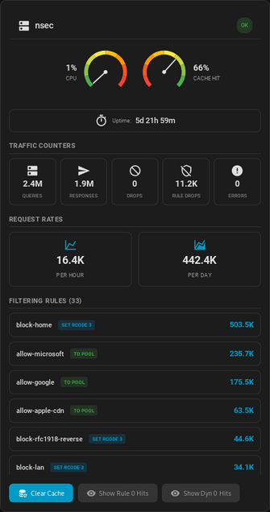

<p align="center">
  
</p>

# PowerDNS **dnsdist** — Home Assistant Integration

[](#changelog)
[](https://www.home-assistant.io/)
[](https://dnsdist.org)
[](https://github.com/renaudallard/homeassistant_dnsdist/actions/workflows/hacs-validation.yml)
[](https://github.com/renaudallard/homeassistant_dnsdist/actions/workflows/ruff.yml)
[](https://github.com/renaudallard/homeassistant_dnsdist/actions/workflows/tests.yml)
[](https://github.com/renaudallard/homeassistant_dnsdist/actions/workflows/mypy.yml)
[](LICENSE)

A secure, high-performance bridge between **PowerDNS dnsdist 2.x** and **Home Assistant 2025.10+**.
Monitor every proxy, surface aggregated insights, and control dnsdist safely through REST-only actions.

<p align="center">
  
</p>

| | |
|---|---|
| **Integration type** | Hub (per-host and per-group devices) |
| **Domain** | `dnsdist` |
| **Current version** | **1.5.0** |
| **Home Assistant** | **2025.10+** |
| **dnsdist** | **2.x** |
| **License** | [BSD 2-Clause](LICENSE) |

---

## Table of Contents

- [Features](#features)
- [Installation](#installation)
- [Configuration](#configuration)
- [Entities](#entities)
- [Lovelace Card](#lovelace-card)
- [Options](#options)
- [Services](#services)
- [Troubleshooting](#troubleshooting)
- [File Map](#file-map)
- [Changelog](#changelog)
- [Support](#support)
- [License](#license)

---

## Features

- **UI-only setup** with zero YAML required
- **Multiple hosts**, each dnsdist endpoint becomes its own device
- **Aggregated groups** with smart rollups (sum counters, average CPU, max uptime, priority security status)
- **Backend monitoring** with per-backend health (binary sensor) and query counters
- **Member reachability** with one binary sensor per group member, so a host that stops answering is visible
- **Filtering rule sensors** for per-rule match counts with idle/active icons
- **Dynamic rule sensors** for temporary blocks (dynblocks) from rate limiting and DoS protection
- **Custom Lovelace card** with gauges, counters, filtering rules, and dynamic rules
- **Long-term statistics ready** sensors (`TOTAL_INCREASING` counters, `MEASUREMENT` percentages)
- **Rolling request rates** (`req_per_hour`, `req_per_day`) with history persisted across restarts, written at most every 5 minutes and on shutdown
- **Secure by default** with HTTPS and SSL verification
- **Diagnostics bundle** with automatic secret redaction
- **REST-only service**: `clear_cache`
- **Reconfigurable** connection parameters (host, port, API key, SSL) without removing the entry

---

## Installation

> Requires Home Assistant **2025.10** or newer.

### HACS (recommended)

[](https://my.home-assistant.io/redirect/hacs_repository/?owner=renaudallard&repository=homeassistant_dnsdist&category=integration)

1. Click the button above (or add `https://github.com/renaudallard/homeassistant_dnsdist` as a custom repository in HACS, category *Integration*)
2. Install **PowerDNS dnsdist** from HACS
3. Restart Home Assistant
4. Go to **Settings > Devices & Services > + Add Integration** and pick **PowerDNS dnsdist**

### Manual

1. Copy `custom_components/dnsdist/` into your Home Assistant `config/custom_components/` directory
2. Restart Home Assistant
3. Go to **Settings > Devices & Services > + Add Integration** and pick **PowerDNS dnsdist**

---

## Configuration

### Add a Host

| Field | Description |
|---|---|
| **Name** | Display name for Home Assistant, unique across hosts and groups |
| **Host / Port** | dnsdist API endpoint (default port `8083`) |
| **API Key** | Optional |
| **Use HTTPS / Verify SSL** | Toggle TLS and certificate validation |
| **Update interval** | Polling frequency in seconds (default `30`) |
| **Create filtering and dynamic rule sensors** | Disabled by default |

Host validation enforces RFC 1123 hostnames plus IPv4/IPv6 literals. IPv6 is stored bracketed, with or without the brackets typed in.
Setup requires a valid dnsdist statistics JSON payload before finishing, so wrong URLs or non-dnsdist endpoints fail fast.

### Add a Group

| Field | Description |
|---|---|
| **Group name** | Home Assistant device label, unique across hosts and groups |
| **Members** | Choose from existing host names |
| **Update interval** | Default `30` seconds |
| **Create filtering and dynamic rule sensors** | Enabled by default |

Group rollups: **sum** (counters), **avg** (CPU %), **max** (uptime), and priority **security status** (critical > warning > ok > unknown).

A host that stops answering keeps publishing its last known figures rather than
going unavailable, so the group would otherwise aggregate a dead member without
saying so. Each group therefore carries one `Member <host>` binary sensor per
member, on for a host that answered its last poll and off for one that did not.
A member whose entry is unloaded, disabled or deleted reports nothing at all,
since that is not the same as a host refusing to answer.

---

## Entities

Each host or group creates a Home Assistant device with these sensors:

| Sensor | Unit | State class |
|---|---|---|
| `queries`, `responses`, `drops`, `rule_drop`, `downstream_errors`, `cache_hits`, `cache_misses` | count | `TOTAL_INCREASING` |
| `cacheHit`, `cpu` | % | `MEASUREMENT` |
| `uptime` | seconds | `MEASUREMENT` |
| `req_per_hour`, `req_per_day` | count | `MEASUREMENT` |
| `security_status` | string | - |

`cpu` covers user plus system time and is not capped at 100: dnsdist runs a
thread per core, so a busy proxy on four cores legitimately reports up to 400.
The card gauge tops out at 100 while the figure beside it stays exact.

dnsdist keeps no single drop counter, so `drops` is the sum of `acl-drops`,
`rule-drop`, `dyn-blocked`, `no-policy` and `noncompliant-queries`. `rule_drop`
is part of that sum and keeps its own sensor as the per-rule breakdown.

Additional dynamic entities (created per backend / per rule):

| Entity | Type | Description |
|---|---|---|
| `Backend <address>` | binary sensor | Backend health (up/down) |
| `Backend <address> Queries` | sensor | Per-backend query counter (`TOTAL_INCREASING`) |
| `Filter <rule name>` | sensor | Per-rule match count with idle/active icons |
| `Dynblock <network>` | sensor | Block count with reason, action, time remaining |
| `Member <host>` | binary sensor | Group only: whether that member answered its last poll |

> Request rates start out scaled up from whatever history exists. Once an hour of history has built up,
> the hourly figure becomes a real count over the trailing hour. The daily figure stays scaled from the
> retained 24 hours, which comes within a rounding error of the measured count once a day has gone by.

There is no backend enable/disable switch. dnsdist serves its HTTP API from an
exact-path handler table and only accepts a write on the cache and the ACL, so
no REST call can take a backend out of rotation. Use `setDown()` on the console
instead.

Dynamic entities are removed as soon as their dnsdist object is gone: an expired dynblock, a deleted
filtering rule, a backend taken out of the configuration. The registry is also reconciled when the entry
is set up, so anything that disappeared while Home Assistant was stopped is cleaned up on the next start.
A device left behind by renaming a host or group is removed once it holds no entities, and can be deleted
from the device page in the meantime.

Filtering rule entities are keyed on the rule name. dnsdist mints a new random UUID for every rule each
time it loads its configuration, so a UUID based identity would create a fresh set of sensors on every
dnsdist restart. Rules without a `name=` are keyed on their expression text instead. Give a rule an
explicit `name=` in `dnsdist.conf` to keep its sensor across an edit of the expression.

---

## Lovelace Card

The integration includes a custom Lovelace card that is automatically registered on load.

**Features:** security status badge, CPU and cache hit needle gauges, uptime display, traffic counters grid, request rate tiles, filtering rules list sorted by match count, dynamic rules list, show/hide zero-hit toggle buttons, clear cache button with confirmation, light/dark theme support, compact mode for sidebars.

### Manual resource registration

If needed, go to **Settings > Dashboards > Resources** and add `/dnsdist_static/dnsdist-card.js?v=1.5.0` as a JavaScript Module.

### Usage

Add the card via the UI card picker (search for "dnsdist") or manually:

```yaml
type: custom:dnsdist-card
entity_prefix: dns1              # Required: matches your dnsdist device name
title: My DNS Server             # Optional: custom card title
show_filters: true               # Optional: show filtering rules (default: true)
show_dynamic_rules: true         # Optional: show dynamic rules (default: true)
show_actions: true               # Optional: show action buttons (default: true)
compact: false                   # Optional: compact mode for sidebars (default: false)
```

| Option | Type | Default | Description |
|---|---|---|---|
| `entity_prefix` | string | *required* | Device name prefix for entity IDs |
| `title` | string | entity_prefix | Custom card title |
| `show_filters` | boolean | `true` | Show filtering rules section |
| `show_dynamic_rules` | boolean | `true` | Show dynamic rules section |
| `show_actions` | boolean | `true` | Show action buttons |
| `compact` | boolean | `false` | Compact mode for sidebars |

A visual configuration editor is also available through the Lovelace UI.

---

## Options

From the integration options panel:

- Rename a host or group, with any group that lists the host following the new name
- Tune the update interval
- Add or remove group members
- Toggle filtering and dynamic rule sensors (hosts default off, groups default on)
- Optionally delete the existing filtering and dynblock sensors when disabling

To change connection parameters (host, port, API key, SSL), use the **Reconfigure** button on the integration card.

---

## Services

`clear_cache` is the only service, because expunging the packet cache is the
only state change dnsdist accepts over its HTTP API.
Supplying `host` targets one host by display name, or by the entity ID spelling of it; omit it to broadcast to every host (groups excluded).

### `dnsdist.clear_cache`

```yaml
service: dnsdist.clear_cache
data:
  host: "amandil"  # optional
  pool: ""         # optional
```

Each host and group device also exposes a **Clear Cache** button. Group presses cascade to all members.

---

## Troubleshooting

| Symptom | Resolution |
|---|---|
| **Request timed out after 10s** | The dnsdist host did not respond in time. Check reachability and webserver load. |
| **Group shows "No active members yet"** | Normal until each member host completes its first refresh. |
| **Counters missing from Recorder** | Counters use `TOTAL_INCREASING` with `count` unit, ensuring long-term statistics work correctly. |
| **Reconfigure connection** | Use the "Reconfigure" button on the integration card to change host, port, API key, or SSL settings. |
| **REST prerequisites** | Ensure the dnsdist webserver is enabled, has an API key, and allows your HA network in the ACL. |
| **Unavailable filter or dynblock entities** | They are removed automatically when the entry reloads. Reload the integration to clear them immediately. |
| **A filtering rule sensor changed entity ID** | Its identity moved from the dnsdist UUID to the rule name. Set `name=` on the rule in `dnsdist.conf` to pin it. |

**Diagnostics:** Visit **Settings > Devices & Services > PowerDNS dnsdist > ... > Download diagnostics**. Secrets are automatically redacted.

---

## File Map

```
custom_components/dnsdist/
  __init__.py          config_flow.py       coordinator.py
  manifest.json        options_flow.py      group_coordinator.py
  const.py             sensor.py            button.py
  utils.py             services.py          diagnostics.py
  strings.json         services.yaml        binary_sensor.py
  translations/
    en.json
  brand/               icon.png, logo.png (HA 2026.3+)
  frontend/
    src/               dnsdist-card.ts, dnsdist-card-editor.ts,
                       styles.ts, types.ts
  www/
    dnsdist-card.js    Built card bundle
```

---

## Changelog

### 1.5.0

Breaking:
- Remove the backend enable/disable switches. dnsdist serves its API from an exact-path handler table and allows a write on nothing but the cache and the ACL, so every toggle came back 405 and the state read compared against "off", which dnsdist never reports. The leftover entities are deleted from the registry on the first startup after the upgrade, so a dashboard card pointing at one needs removing
- Remove the `enable_server`, `disable_server` and `get_backends` services for the same reason. The first two were rejected with 405 and the third asked for `/api/v1/servers`, which is not a route dnsdist has. An automation calling one now fails instead of quietly doing nothing
- The per-backend `drops` attribute is now `send_errors`, taken from the `sendErrors` counter dnsdist actually keeps. The old name matched no field in the server JSON and always read zero
- `cpu` now counts system time as well as user time and is no longer capped at 100, because dnsdist runs a thread per core. A gauge card pinned to a maximum of 100 will peg on a busy host
- `drops` was reading a statistic dnsdist has never had and sat at zero on every version. It is now the sum of `acl-drops`, `rule-drop`, `dyn-blocked`, `no-policy` and `noncompliant-queries`, so the sensor steps up from a flat line

Added:
- A connectivity binary sensor per group member, so a host that stops answering is visible instead of the group aggregating its last known figures in silence. A member whose entry is unloaded, disabled or deleted reports unknown rather than disconnected
- Reject a host or group name another entry already uses, since the name keys the device and picks the target of the services
- A rename now follows through into every group that lists the host, instead of silently dropping it from the aggregate

Fixed:
- Bracket a bare IPv6 host so the API URL parses. `2001:db8::1` was accepted at setup and then produced an unparseable URL, which setup blamed on the connection
- Let a group shrink again when a member is disabled. A disabled entry counted towards the quorum it could never satisfy, freezing the group's rule and dynblock sensors for good
- Stop a group refreshing itself while it is being unloaded, which ran an aggregation against a torn down coordinator and could rewrite a history file that had just been deleted
- Treat an unreadable dynblock response as unread rather than empty. An empty mapping is the signal that dnsdist has no dynamic blocks left, so anything but a JSON object deleted every dynblock sensor
- Keep one unreadable statistic from taking down every statistic after it
- Ignore a CPU reading with no counters in it, which used to rebase the baseline and spike the next poll
- Space the request history writes 5 minutes apart and hand them to the store. The throttle matched the default poll interval, so up to 2881 samples were rewritten to disk on nearly every cycle
- Match a `clear_cache` host by its entity ID spelling as well as its display name, and say so when the name matches nothing
- Give a rejected form back the values that were typed into it
- Do not try to remove an entity that has not finished being added
- Stop the card claiming entities that only look vaguely like rules; an unrelated sensor carrying an `action` attribute could land in the filtering rules list
- Drop the daily rate branch that could never run, and stop the rate going negative after a counter reset

Internal:
- One shared answer to whether an entry is a host or a group, which setup and the platforms used to spell differently
- Drop a diagnostics hook Home Assistant never calls, a button attribute that does not exist, a card option nothing read, and the styles and strings behind them
- Keep the bookkeeping flag for service registration out of the coordinator map
- Raise the HACS minimum to 2025.10, which is what the code has wanted for a while
- Pin the ruff target to py313 so the formatter stops proposing 3.14 only syntax, and run both ruff steps over the tests in CI

### 1.4.3
- Remove filtering rule, dynblock and backend entities once their dnsdist object is gone, including at startup for anything that disappeared while Home Assistant was stopped
- Key filtering rule sensors on the rule name rather than the dnsdist UUID, which is regenerated on every config load; existing sensors are migrated where the old UUID is still known
- Keep group rule sensors while a member is unreachable or reloading, and clear expired dynblocks once every member has reported
- Delete dynblock sensors too when the rule sensor option is switched off, and only once the options form is accepted
- Add device removal support and clean up the device left behind by renaming a host or group
- Delete the stored request history when an entry is removed

### 1.4.2
- Add backend monitoring: per-backend health binary sensor, query counter sensor, and enable/disable switch
- Refactor coordinator to fetch server config once for both filtering rules and backends (no extra HTTP request)

### 1.4.1
- Add reconfigure flow to change host, port, API key, and SSL settings without removing the entry
- Fix empty "Fetch error:" log on timeout, now logs a proper message
- Add 10s timeout to service API calls to prevent hanging
- Use consistent 10s timeout in config flow connection validation (was 5s)
- Cap rolling history deque to 24 hours of samples to prevent unbounded memory growth
- Add comprehensive unit tests for coordinator normalization, group aggregation, and service encoding

### 1.4.0
- Add local `brand/` directory with `icon.png` and `logo.png` for HA 2026.3+ custom integration branding
- Fix dispatcher signal leak: group coordinators no longer react to reload signals after entry unload
- Fix system diagnostics producing a spurious error entry from the `_services_registered` sentinel
- Fix filtering/dynamic rule preservation: rule sensors now retain last known values when the rules endpoint temporarily fails instead of resetting to zero
- Remove dead `async_get_options_flow` standalone function in options flow module

### 1.3.9
- Replace Lovelace resource polling loop with direct `async_load()` guard
- Fix swallowed `ConfigEntryNotReady` that prevented HA from retrying setup
- Remove dead secret storage API code
- Use identity comparison for `CoreState` enum to match HA core convention

### 1.3.8
- Fix crash on Home Assistant 2026.2+ where `LovelaceData` no longer has a `.mode` attribute

### 1.3.7
- Add separate toggle buttons for filtering rules and dynamic rules with zero matches
- Fix missing ATTR_* constants that caused integration to fail on load

### 1.3.6
- Add toggle button to show/hide dynamic rules with zero hits
- Extrapolate request rates from available history when less than 1h/24h of data
- Fix expired dynblock sensors not being removed from entity registry

### 1.3.3
- Fix OptionsFlow compatibility with newer Home Assistant versions

### 1.3.2
- Fix dynamic rules not being removed from card when they expire
- Fix time remaining countdown not updating in real-time

### 1.3.1
- Redesign gauge layout for more compact display

### 1.3.0
- Add dynamic rules (dynblocks) support with sensors and Lovelace card section
- Group aggregation for dynamic rules with source tracking

### 1.2.1
- Redesign gauge visualization with needle indicator and segmented color gradient arc

### 1.2.0
- Add custom Lovelace card with gauges, counters, filtering rules, and visual editor
- Auto-register frontend resource on integration load

### 1.1.18
- Fix SSL verification logic and improve error handling

### 1.1.17
- Fix schema serialization and config flow validation; add unit tests and CI workflows

### 1.1.16
- Fix linting errors, add missing imports, remove blocking sleep, standardize timeout style

### 1.1.15
- Extract shared utilities into `utils.py` and `HistoryMixin`; centralize constants

### 1.1.14
- Remove deprecated HACS metadata; run HACS validation with default checks

### 1.1.13
- Add HACS validation workflow; align manifests with current requirements

### 1.1.12
- Validate host entries against RFC 1123; verify dnsdist statistics payload during setup

### 1.1.11
- Streamline rolling-window rate calculations

### 1.1.10
- Sanitize backend identifiers in REST services

### 1.1.9
- Preserve query history across restarts for rolling rate sensors

### 1.1.8
- Preload platforms during startup; compatibility fallback for removed `COUNT` unit

### 1.1.7
- Report counters with `count` unit for Recorder statistics

### 1.1.6
- Per-entry control over filtering rule sensors with auto-delete option

### 1.1.5
- Interpolate counters at window horizon for accurate rolling totals

### 1.1.4
- Report actual rolling-window volume instead of extrapolated estimates

### 1.1.3
- Reuse shared HTTP session for all API calls

### 1.1.2
- Switch to REST-only services; single Clear Cache button

### 1.1.1
- Add `req_per_hour` and `req_per_day` sensors; fix duplicate device name in display

### 1.1.0
- HA 2025.10 compatibility; stable entity modeling; robust device identifiers

---

## Support

If you find this integration useful, you can support its development:

[](https://www.paypal.me/RenaudAllard)

---

## License

**BSD 2-Clause** -- see [`LICENSE`](LICENSE).
